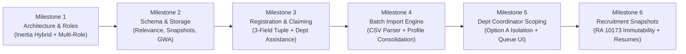

# ATMS — Milestones & Technical Achievements

**Project:** Alumni Tracer Management System (ATMS)  
**Architecture:** Inertia.js React Hybrid (Laravel 12 + React 19 + TypeScript + Tailwind CSS + shadcn/ui)  
**Test Suite:** 87 Tests Passed (488 Assertions) — 100% Green  
**Status Date:** November 2026  

---

## 1. Executive Summary

The platform has established a production-ready, test-driven foundation combining the Laravel monolith backend with a responsive Inertia.js React frontend. All strategic architectural decisions, data isolation boundaries, and core modules outlined in `docs/master-prompt.md` have been implemented and verified.

---

## 2. Detailed Milestone Achievements

### Milestone 1: Inertia.js Hybrid Architecture & Multi-Role User System
* **Unified Application Structure**: Built as an Inertia.js React hybrid rather than a decoupled SPA, providing session authentication, CSRF token handling, server-side routing, and SPA navigation.
* **Simultaneous Multi-Role Support**: Single user accounts can hold multiple roles simultaneously (`system-administrator`, `alumni-coordinator`, `department-coordinator`, `alumni`, `employer`) in `user_roles`.
* **Workspace Role Switcher**: Interactive dropdown in the portal sidebar allowing users to switch active workspace contexts on the fly without logging out.
* **Role-Adaptive Layout**: Dynamic sidebar navigation and dashboard components that adapt to the active role.

### Milestone 2: Relational Database Schema & Data Modeling
* **Database Tables (42 Normalized Tables)**: Complete schema spanning academic catalog, alumni roster, education credentials, tracer records, surveys, job portal, and audit logs.
* **Schema Extensions**:
  * `is_related_to_degree` (`BOOLEAN DEFAULT TRUE`) on `alumni_employment_records` (Option B relevance flag).
  * `profile_snapshot` (`JSON`) and `resume_snapshot_path` (`VARCHAR(255)`) on `job_applications`.
  * `academic_program_id` (`BIGINT UNSIGNED NULL`) on `alumni_registration_assistance_requests`.
  * `gwa` (`DECIMAL(4,2) NULL`) on `alumni_education_records`.
* **Centralized Alumni Identity (Section 6 Rule)**: Enforced one centralized `AlumniProfile` per individual, supporting multiple student numbers, degrees, and graduation years under that single profile.

### Milestone 3: Alumni Claiming & Registration Assistance Workflow
* **3-Field Verification Tuple**: Account claiming enforces:
  1. `student_number` (matched against roster records).
  2. `last_name` (normalized, case-insensitive match).
  3. `date_of_birth` (exact `Y-m-d` match).
* **Decoupled User Email**: Alumni can register using their current personal email (e.g., Gmail) without requiring a match to legacy college roster emails.
* **Automated Assistance Generation**: If any of the 3 fields mismatch or the record is missing, an `AlumniRegistrationAssistanceRequest` is automatically created and routed to the corresponding Academic Program Coordinator.
* **Fortify Action Refactor**: Implemented inside `CreateNewUser.php` with rate limiting, audit logging (`registration_attempt`, `registration_completed`, `account_auto_verified`, `assistance_requested`), and password validation.

### Milestone 4: Alumni Batch Import Engine & UI
* **High-Performance CSV Parser** (`AlumniImportService.php`):
  * Auto-detects delimiters (comma `,`, semicolon `;`, or tab `\t`) and strips UTF-8 BOM headers.
  * Consolidates multi-degree records under one profile by matching full name and date of birth.
  * Auto-provisions missing academic programs, departments, and degrees on the fly if not yet seeded in the catalog.
  * Catches and isolates duplicate student numbers with line-by-line error reporting.
* **Batch Import API Endpoints**:
  * `POST /api/alumni/import`: File upload endpoint with size validation (up to 20MB) and activity audit logging.
  * `GET /api/alumni/import-template`: Downloads a formatted CSV sample template.
* **Interactive Frontend Modal**:
  * Drag-and-drop file picker with file size preview.
  * Real-time import summary card (total processed, successful, failed, profiles created, education records created).
  * Collapsible error log with row numbers and exact validation failure reasons.
  * Automatic directory table reload upon import.

### Milestone 5: Department Coordinator Scoped Record Isolation (Option A)
* **Directory Isolation**: Department Coordinators only see alumni records and education credentials associated with their assigned academic programs. Unrelated degrees earned across other departments are stripped from API resources (`AlumniProfileResource.php`).
* **Multi-Role Bypass**: System Administrators and Alumni Coordinators retain institution-wide visibility across all departments and graduating cohorts.
* **Department Coordinator Assistance Queue UI**:
  * Dedicated **"Claim assistance"** tab in the Department Coordinator workspace.
  * Scoped list of pending student verification requests.
  * One-click approval button (`Approve claim`) with registrar verification notes.
  * Review modal with configurable decision outcomes (`reviewed`, `needs_more_information`, `rejected`).

### Milestone 6: Employment Tracer with Degree Relevance (Option B)
* **Relevance Flag Integration**:
  * Form toggle: *"This employment is related to my college degree / field of study"* (Yes / No).
  * Stored in `alumni_employment_records.is_related_to_degree`.
  * Visual status badges (`Degree-Related` vs `Non-Degree Related`) in the employment history timeline.
* **Report #8 Backend Support**: `AlumniReportService::degreeRelevanceOutcomes()` aggregates degree relevance outcomes by graduation year, program, and department.

### Milestone 7: Job Application Frozen Snapshot & Data Privacy (RA 10173)
* **Immutable Snapshotting**: When an alumnus applies for a job posting:
  * Profile details, academic qualifications (with GWA & honors), and current employment history are serialized into a frozen JSON payload (`job_applications.profile_snapshot`).
  * Submitted resume files are stored securely under `applications/{job_id}/resumes/` on the private disk.
* **Snapshot Immutability**: Subsequent profile edits by the alumnus do not mutate previously submitted applications.
* **Employer Access Boundaries**:
  * Employers can only view applicants who submitted applications directly to their own job postings.
  * Secured resume download endpoint: `GET /api/applications/{application}/resume`.

### Milestone 8: Single-User Employer Model
* **1-to-1 Corporate Tenancy**: Each company profile is owned and operated by a single user account without team invitation overhead.
* **Gated Job Publication**: Company verification status starts as `pending` upon registration; job vacancies cannot be published until verified by an Administrator or Alumni Coordinator.

---

## 3. Automated Test Suite Status

Executed via `php artisan test`:

| Test Suite File | Tests | Assertions | Status |
| :--- | :---: | :---: | :---: |
| `tests/Feature/Api/StrategicDecisionsTest.php` | 5 | 39 | **Passed** |
| `tests/Feature/Api/AlumniImportTest.php` | 4 | 21 | **Passed** |
| `tests/Feature/Api/AlumniBackendApiTest.php` | 13 | 55 | **Passed** |
| `tests/Feature/Api/PhaseFiveApiTest.php` | 15 | 88 | **Passed** |
| `tests/Feature/Auth/AlumniRegistrationTest.php` | 6 | 28 | **Passed** |
| `tests/Feature/Auth/RegistrationTest.php` | 2 | 11 | **Passed** |
| `tests/Feature/Auth/AuthenticationTest.php` | 5 | 16 | **Passed** |
| `tests/Feature/Auth/PasswordUpdateTest.php` | 3 | 12 | **Passed** |
| `tests/Feature/Auth/TwoFactorAuthenticationTest.php` | 6 | 22 | **Passed** |
| `tests/Feature/Settings/ProfileUpdateTest.php` | 8 | 44 | **Passed** |
| `tests/Feature/Settings/SecurityTest.php` | 6 | 28 | **Passed** |
| **Total Test Suite** | **87** | **488** | **100% Passed** |

---

## 4. Current Workspaces & Role Navigation

| Role | Available Workspace Modules | Data Scope |
| :--- | :--- | :--- |
| **System Administrator** | Overview, Notifications, Alumni Directory, Academic Programs, Surveys, Announcements, Employers & Jobs, Reports, Users & Roles, Activity Log | Institution-wide |
| **Alumni Coordinator** | Overview, Notifications, Alumni Directory (with CSV Import), Surveys, Announcements, Employers & Jobs, Reports | Institution-wide |
| **Department Coordinator** | Overview, Notifications, Program Alumni, Claim Assistance Queue, Employment Outcomes, Surveys, Announcements, Department Reports | Assigned Programs Only (Option A) |
| **Alumni** | My Dashboard, Notifications, My Profile, Academic Records, Employment Tracer (Option B), Surveys, Announcements, Career Opportunities, My Applications | Self-profile Only |
| **Employer** | Overview, Notifications, Company Profile, Job Postings, Applicants (with Frozen Snapshots & Resumes), Recruitment Analytics | Owned Postings Only |

---

## 5. Next Planned Milestones

1. **Institutional Reports & Exports (Section 12)**: The 18 tracer reports with PDF & Excel download generators.
2. **Public Website & Guest Experience (Section 4)**: Public job board, public announcements, and guest registration landing.
3. **Custom Survey Builder (Section 9)**: Visual question builder with cohort targeting by academic program and graduation year.

