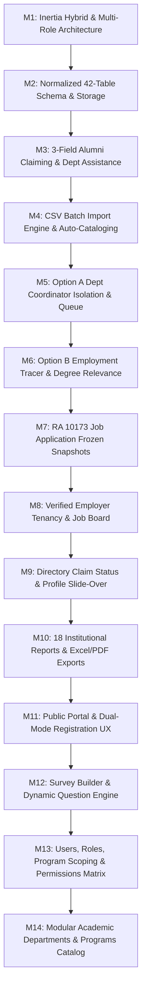

# ATMS — Milestones & Technical Achievements

**Project:** Alumni Tracer Management System (ATMS)  
**Architecture:** Inertia.js React Hybrid (Laravel 12 + React 19 + TypeScript + Tailwind CSS + shadcn/ui)  
**Test Suite:** 99 Tests Passed (794 Assertions) — 100% Green  
**Status Date:** November 2026  

---

## 1. Executive Summary

The platform has established a production-ready, test-driven foundation combining the Laravel monolith backend with a responsive Inertia.js React frontend. All strategic architectural decisions, data isolation boundaries, and core modules outlined in `docs/master-prompt.md` have been implemented and verified.

---

## 2. Detailed Milestone Achievements

### Milestone 1: Inertia.js Hybrid Architecture & Multi-Role User System
* **Unified Application Structure**: Built as an Inertia.js React hybrid rather than a decoupled SPA, providing session authentication, CSRF token handling, server-side routing, and SPA navigation.
* **Simultaneous Multi-Role Support**: Single user accounts can hold multiple roles simultaneously (`system-administrator`, `alumni-coordinator`, `department-coordinator`, `alumni`, `employer`) in `user_roles`.
* **Workspace Role Switcher**: Interactive dropdown in the portal sidebar allowing users to switch active workspace contexts on the fly without logging out.
* **Role-Adaptive Layout**: Dynamic sidebar navigation and dashboard components that adapt to the active role.

### Milestone 2: Relational Database Schema & Data Modeling
* **Database Tables (42 Normalized Tables)**: Complete schema spanning academic catalog, alumni roster, education credentials, tracer records, surveys, job portal, and audit logs.
* **Schema Extensions**:
  * `is_related_to_degree` (`BOOLEAN DEFAULT TRUE`) on `alumni_employment_records` (Option B relevance flag).
  * `profile_snapshot` (`JSON`) and `resume_snapshot_path` (`VARCHAR(255)`) on `job_applications`.
  * `academic_program_id` (`BIGINT UNSIGNED NULL`) on `alumni_registration_assistance_requests`.
  * `gwa` (`DECIMAL(4,2) NULL`) on `alumni_education_records`.
* **Centralized Alumni Identity (Section 6 Rule)**: Enforced one centralized `AlumniProfile` per individual, supporting multiple student numbers, degrees, and graduation years under that single profile.

### Milestone 3: Alumni Claiming & Registration Assistance Workflow
* **3-Field Verification Tuple**: Account claiming enforces:
  1. `student_number` (matched against roster records).
  2. `last_name` (normalized, case-insensitive match).
  3. `date_of_birth` (exact `Y-m-d` match).
* **Decoupled User Email**: Alumni can register using their current personal email (e.g., Gmail) without requiring a match to legacy college roster emails.
* **Automated Assistance Generation**: If any of the 3 fields mismatch or the record is missing, an `AlumniRegistrationAssistanceRequest` is automatically created and routed to the corresponding Academic Program Coordinator.
* **Fortify Action Refactor**: Implemented inside `CreateNewUser.php` with rate limiting, audit logging (`registration_attempt`, `registration_completed`, `account_auto_verified`, `assistance_requested`), and password validation.

### Milestone 4: Alumni Batch Import Engine & UI
* **High-Performance CSV Parser** (`AlumniImportService.php`):
  * Auto-detects delimiters (comma `,`, semicolon `;`, or tab `\t`) and strips UTF-8 BOM headers.
  * Consolidates multi-degree records under one profile by matching full name and date of birth.
  * Auto-provisions missing academic programs, departments, and degrees on the fly if not yet seeded in the catalog.
  * Catches and isolates duplicate student numbers with line-by-line error reporting.
* **Batch Import API Endpoints**:
  * `POST /api/alumni/import`: File upload endpoint with size validation (up to 20MB) and activity audit logging.
  * `GET /api/alumni/import-template`: Downloads a formatted CSV sample template.
* **Interactive Frontend Modal**:
  * Drag-and-drop file picker with file size preview.
  * Real-time import summary card (total processed, successful, failed, profiles created, education records created).
  * Collapsible error log with row numbers and exact validation failure reasons.
  * Automatic directory table reload upon import.

### Milestone 5: Department Coordinator Scoped Record Isolation (Option A)
* **Directory Isolation**: Department Coordinators only see alumni records and education credentials associated with their assigned academic programs. Unrelated degrees earned across other departments are stripped from API resources (`AlumniProfileResource.php`).
* **Multi-Role Bypass**: System Administrators and Alumni Coordinators retain institution-wide visibility across all departments and graduating cohorts.
* **Department Coordinator Assistance Queue UI**:
  * Dedicated **"Claim assistance"** tab in the Department Coordinator workspace.
  * Scoped list of pending student verification requests.
  * One-click approval button (`Approve claim`) with registrar verification notes.
  * Review modal with configurable decision outcomes (`reviewed`, `needs_more_information`, `rejected`).

### Milestone 6: Employment Tracer with Degree Relevance (Option B)
* **Relevance Flag Integration**:
  * Form toggle: *"This employment is related to my college degree / field of study"* (Yes / No).
  * Stored in `alumni_employment_records.is_related_to_degree`.
  * Visual status badges (`Degree-Related` vs `Non-Degree Related`) in the employment history timeline.
* **Report #8 Backend Support**: `AlumniReportService::degreeRelevanceOutcomes()` aggregates degree relevance outcomes by graduation year, program, and department.

### Milestone 7: Job Application Frozen Snapshot & Data Privacy (RA 10173)
* **Immutable Snapshotting**: When an alumnus applies for a job posting:
  * Profile details, academic qualifications (with GWA & honors), and current employment history are serialized into a frozen JSON payload (`job_applications.profile_snapshot`).
  * Submitted resume files are stored securely under `applications/{job_id}/resumes/` on the private disk.
* **Snapshot Immutability**: Subsequent profile edits by the alumnus do not mutate previously submitted applications.
* **Employer Access Boundaries**:
  * Employers can only view applicants who submitted applications directly to their own job postings.
  * Secured resume download endpoint: `GET /api/applications/{application}/resume`.

### Milestone 8: Single-User Employer Model
* **1-to-1 Corporate Tenancy**: Each company profile is owned and operated by a single user account without team invitation overhead.
* **Gated Job Publication**: Company verification status starts as `pending` upon registration; job vacancies cannot be published until verified by an Administrator or Alumni Coordinator.

### Milestone 9: Alumni Directory Claim Status & Profile Drawer
* **Claim Status Column & Filter**: Added `is_claimed` (`Claimed` vs `Unclaimed` badge with claim date tooltip) and `?claim_status=claimed|unclaimed` filter to `GET /api/alumni`.
* **Interactive Profile Slide-Over Drawer**: Clicking any alumnus name or `"View profile"` button opens `<AlumniProfileDialog />` displaying personal details, academic degrees (`student_number`, `program`, `degree`, `graduation_year`, `honors`, `gwa`), and full employment history timeline.

### Milestone 10: Institutional Reports & Exports (Section 12)
* **All 18 Institutional Reports**: Implemented in `App\Services\AlumniReportService`:
  1. Alumni Masterlist (`alumni_masterlist`)
  2. Alumni Population by Department (`population_by_department`)
  3. Alumni Population by Academic Program (`population_by_program`)
  4. Alumni Population by Graduation Year (`population_by_graduation_year`)
  5. Employment Rate (`employment_rate`)
  6. Employment Rate by Academic Program (`employment_rate_by_program`)
  7. Employment Rate by Graduation Year (`employment_rate_by_graduation_year`)
  8. Employment Related to Degree (`employment_related_to_degree`)
  9. First Employment Statistics (`first_employment_statistics`)
  10. Average Time to First Employment (`average_time_to_first_employment`)
  11. Further Studies Statistics (`further_studies_statistics`)
  12. Employment History (`employment_history`)
  13. Survey Participation Rate (`survey_participation_rate`)
  14. Survey Response Summary (`survey_response_summary`)
  15. Job Portal Analytics (`job_portal_analytics`)
  16. Job Application Statistics (`job_application_statistics`)
  17. Successful Job Placements (`successful_job_placements`)
  18. Graduate Tracer Summary (`graduate_tracer_summary`)
* **5-Filter Engine & Option A Isolation**: Filtering by Department, Academic Program, Graduation Year, Employment Status, and Date Range (`date_from` / `date_to`), with strict program scoping for Department Coordinators.
* **Native Excel & PDF Export Generators**:
  * `GET /api/reports/export/excel`: Downloads styled SpreadsheetML (`.xls`) workbooks with summary KPI cards and tabular data.
  * `GET /api/reports/export/pdf`: Generates native binary `%PDF-1.4` documents with multi-page layout, KPI summary banner, and formatted rows.

### Milestone 11: Public Website & Registration UX Polish (Section 4)
* **Live Public Website Controller (`App\Http\Controllers\PublicPortalController`)**:
  * Serves `GET /` with real-time published announcements, open job postings from verified employers, active academic departments/programs, and public summary metrics without exposing any confidential alumni data.
* **Interactive Public Job Board, Announcements & Events (`resources/js/pages/welcome.tsx`)**:
  * Searchable and workplace-filterable (`All`, `On-site`, `Hybrid`, `Remote`) Public Job Board with a **Job Details Modal** that deep-links authenticated users directly to `/dashboard?page=Career+opportunities` or prompts guests to sign in / claim their alumni account.
  * Live **Public Announcements** section with an **Announcement Reader Modal** and deep-link to `/dashboard?page=Announcements`.
  * **Alumni Information & Verification Guide** detailing the 3-credential claim workflow (`Student Number` + `Last Name` + `Date of Birth`) and Department Coordinator assistance fallback.
* **Dual-Mode Registration UX (`resources/js/pages/auth/register.tsx` & `CreateNewUser.php`)**:
  * Seamless switcher between **Alumni Claim** (`/register`) and **Employer Partner Registration** (`/register?type=employer`).
  * Employer registration automatically provisions the corporate profile in `pending` verification status and opens the Employer workspace.
* **Deep-Linked Portal Navigation (`resources/js/components/alumni-portal.tsx`)**:
  * Supports `?page=` and `?role=` query parameters on `/dashboard` so public website CTAs open the exact target workspace module immediately.

### Milestone 12: Survey Builder & Dynamic Question Engine (Section 9)
* **Visual Survey Builder & Respondent Experience (`resources/js/components/alumni-portal-data.tsx`)**:
  * Tabbed builder (`Questions` | `Settings & Cohorts` | `Preview Form`), header card, active question focus indicator, interactive option list (`○` radio / `☐` checkbox / `1.` dropdown + `+ Add option` + remove option `✕`), question duplication, reordering (`↑` / `↓`), deletion, and `Required` toggle switch.
  * Structured respondent view (`SurveyResponseForm`) with individual question cards, interactive 1–5 Linear Scale circles, required indicators (`*`), and `Clear form` button.
* **9 Question Types & Cohort Targeting (`App\Models\Survey` & `App\Http\Controllers\Api\SurveyController`)**:
  * Supports Short Text (`text`), Long Text (`textarea`), Multiple Choice (`radio`), Checkbox (`multiselect`), Dropdown (`select`), Rating Scale (`rating` 1–5), Date (`date`), Number (`number`), and Yes/No (`boolean`).
  * Targets cohorts by Department (`target_department_ids`), Academic Program (`target_program_ids`), and Graduation Batch Years (`target_graduation_years`), matching multi-degree alumni if any degree matches while enforcing 1 response per unique alumnus (`409 Conflict` on duplicate).
  * Includes `POST /api/surveys/{survey}/close` and `GET /api/surveys/{survey}/analytics` with anonymous respondent masking (`is_anonymous`).

### Milestone 13: Users, Roles, Academic Program Scoping & Role Permissions Matrix (Section 3)
* **Department Coordinator Academic Program Assignment (`PATCH /api/admin/users/{user}/programs`)**:
  * System Administrators can assign and update specific `AcademicProgram`s (`BSCS`, `BSIT`, `BSBA`, etc.) for any Department Coordinator directly in the `Users & roles` workspace (`AssignedRoles`) or during user creation.
* **Granular Role Permissions Matrix (`PATCH /api/admin/roles/{role}/permissions`)**:
  * System Administrators can view and toggle granular permissions (`alumni.view`, `alumni.create`, `alumni.update`, `reports.view`, `surveys.manage`, `announcements.manage`, `jobs.manage`) for coordinator roles while protecting the `system-administrator` role.
* **Direct Account Creation, Audit Logging & Demo Role Accounts (`SystemAdminUserController` & `SystemAdminSeeder`)**:
  * Supports both email password-setup invitations and direct account creation with an initial password (`email_verified_at` pre-verified).
  * Records activity logs (`user.invited`, `user.roles_updated`, `user.programs_assigned`, `role.permissions_updated`, `user.suspended`, `user.reactivated`, `user.deleted`).
  * Seeded dedicated accounts for every role (`admin@atms.local`, `coordinator@atms.local`, `dept.ccs@atms.local`, `employer@atms.local`, and claimed alumni accounts).

### Milestone 14: Modular Academic Departments & Programs Management (Section 5)
* **Department Creation & Editing (`POST /api/departments` & `PATCH /api/departments/{department}`)**:
  * System Administrators and Alumni Coordinators can create and edit academic departments/colleges (`code`, `name`, `description`) either from a dedicated `+ Create department` form or inline while adding a new academic program (`+ Create new department inline`).
* **Modular Department View & Program Management (`AcademicCatalog` in `resources/js/components/alumni-portal-data.tsx`)**:
  * Toggle between **Modular by Department** (where each Department card groups its own Academic Programs with quick actions like `+ Add program here` and `Edit department`) and **All Programs Grid**.
  * Supports editing existing programs (`PATCH /api/programs/{program}`), creating an initial degree offering on program creation, and adding additional degree offerings inline (`POST /api/programs/{program}/degrees`).

---

## 3. Automated Test Suite Status

Executed via `php artisan test`:

| Test Suite File | Tests | Assertions | Status |
| :--- | :---: | :---: | :---: |
| `tests/Feature/Api/SurveyBuilderTargetingTest.php` | 1 | 19 | **Passed** |
| `tests/Feature/Api/SystemAdminUserManagementTest.php` | 9 | 78 | **Passed** |
| `tests/Feature/PublicPortalAndRegistrationTest.php` | 2 | 49 | **Passed** |
| `tests/Feature/Api/InstitutionalReportsTest.php` | 4 | 197 | **Passed** |
| `tests/Feature/Api/AlumniClaimStatusTest.php` | 2 | 13 | **Passed** |
| `tests/Feature/Api/StrategicDecisionsTest.php` | 5 | 39 | **Passed** |
| `tests/Feature/Api/AlumniImportTest.php` | 4 | 21 | **Passed** |
| `tests/Feature/Api/AlumniBackendApiTest.php` | 14 | 67 | **Passed** |
| `tests/Feature/Api/PhaseFiveApiTest.php` | 15 | 88 | **Passed** |
| `tests/Feature/Auth/AlumniRegistrationTest.php` | 6 | 28 | **Passed** |
| `tests/Feature/Auth/RegistrationTest.php` | 2 | 11 | **Passed** |
| `tests/Feature/Auth/AuthenticationTest.php` | 5 | 16 | **Passed** |
| `tests/Feature/Auth/PasswordUpdateTest.php` | 3 | 12 | **Passed** |
| `tests/Feature/Auth/TwoFactorAuthenticationTest.php` | 6 | 22 | **Passed** |
| `tests/Feature/Settings/ProfileUpdateTest.php` | 8 | 44 | **Passed** |
| `tests/Feature/Settings/SecurityTest.php` | 6 | 28 | **Passed** |
| **Total Test Suite** | **99** | **794** | **100% Passed** |

---

## 4. Current Workspaces & Role Navigation

| Role | Available Workspace Modules | Data Scope |
| :--- | :--- | :--- |
| **System Administrator** | Overview, Notifications, Alumni Directory, Claim Assistance, Academic Programs, Surveys (Visual Builder), Announcements, Employers & Jobs, Reports (18 Reports + Excel/PDF), Users & Roles (with Program Scoping & Permissions Matrix), Activity Log | Institution-wide |
| **Alumni Coordinator** | Overview, Notifications, Alumni Directory (with CSV Import), Claim Assistance, Surveys (Visual Builder), Announcements, Employers & Jobs, Reports (18 Reports + Excel/PDF) | Institution-wide |
| **Department Coordinator** | Overview, Notifications, Program Alumni, Claim Assistance Queue, Employment Outcomes, Surveys, Announcements, Department Reports (18 Reports Scoped) | Assigned Programs Only (Option A) |
| **Alumni** | My Dashboard, Notifications, My Profile, Academic Records, Employment Tracer (Option B), Surveys, Announcements, Career Opportunities, My Applications | Self-profile Only |
| **Employer** | Overview, Notifications, Company Profile, Job Postings, Applicants (with Frozen Snapshots & Resumes), Recruitment Analytics | Owned Postings Only |

---

## 5. Seeded Institutional & Demo Accounts

Seeded via `php artisan db:seed --class=SystemAdminSeeder` (default password: `Password123!`):

| Role | Name | Email | Scope / Linked Entity |
| :--- | :--- | :--- | :--- |
| **System Administrator** | System Administrator | `admin@atms.local` | Institution-wide + multi-role workspace preview |
| **Alumni Coordinator** | Elena Vance | `coordinator@atms.local` | Institution-wide alumni, surveys, announcements & reports |
| **Department Coordinator** | Dr. Alan Grant | `dept.ccs@atms.local` | Scoped to `BSCS` & `BSIT` (`user_program_assignments`) |
| **Employer Partner** | Sophia Lin (TechNova HR) | `employer@atms.local` | Linked to verified company *TechNova Solutions Inc.* |
| **Claimed Alumni** | Maria Clara Reyes | `maria.reyes@example.com` | Linked to `AlumniProfile #3` |

