# Phase 2 — Database Architecture

## Status and scope

This document is the Phase 2 logical and physical database design for the Alumni
Tracer Management System. It specifies the MySQL schema, keys, constraints,
indexes, relationships, and normalization decisions, along with implementation
notes through **Milestone 18** (`docs/milestones-achieved.md`).

The design covers authentication and authorization, academic records, alumni
registration and claims, employment tracing, surveys, announcements and events,
employers and recruitment, reporting support, imports, notifications, and audit
records.

### Milestone 1–18 implementation notes

In the implemented migrations (`database/migrations/`), the following practical
refinements were adopted on top of this specification:

- **Account-to-Alumni Claim Link**: Stored via a unique nullable
  `users.alumni_profile_id` foreign key referencing `alumni_profiles.id`.
- **Education Credentials (`alumni_education_records`)**: Includes `gwa`
  (`DECIMAL(4,2) NULL`) alongside `student_number`, `program_degree_id`,
  `graduation_year`, and `honors`.
- **Employment Tracer Relevance (`alumni_employment_records`)**: Includes
  `is_related_to_degree` (`BOOLEAN DEFAULT TRUE`) for Option B curriculum
  alignment reporting.
- **RA 10173 Job Application Snapshots (`job_applications`)**: Stores immutable
  `profile_snapshot` (`JSON`) and `resume_snapshot_path` (`VARCHAR(255)`) at the
  moment of application submission.
- **Cohort Targeting Columns**: `surveys`, `announcements`, and `alumni_events`
  use JSON array targeting columns (`target_department_ids`,
  `target_program_ids`, `target_graduation_years`, `audience_roles`) to filter
  multi-degree alumni efficiently.
- **Claim Assistance Diagnostics (`alumni_registration_assistance_requests`)**:
  Includes `academic_program_id`, `graduation_year`, `resolution_action`, and
  `resolved_alumni_profile_id` for coordinator routing and one-click resolution.

## Database conventions

- Target MySQL 8.0.16 or later with InnoDB, `utf8mb4`, and strict SQL mode.
- `id` is `BIGINT UNSIGNED AUTO_INCREMENT`; foreign keys use the same type.
- `created_at` and `updated_at` are nullable `DATETIME` values unless a table
  has a more specific event timestamp. Store and compare timestamps in UTC.
- `TINYINT(1)` represents booleans. Use `DATE` for dates without a time and
  `DECIMAL` for monetary and numeric values requiring exact precision.
- Use `VARCHAR` for bounded identifiers and labels, `TEXT` for long text, and
  `JSON` only for variable-shaped payloads or retained import snapshots—not
  ordinary relationships or queryable business attributes.
- Status values are stored as constrained `VARCHAR` codes (or lookup-table
  foreign keys where the value has attributes); application validation keeps
  codes within the documented sets.
- Foreign keys use `RESTRICT` for canonical business records, `CASCADE` for
  dependent join/child rows, and `SET NULL` for optional audit actors. Do not
  hard-delete alumni, accounts, education records, applications, or audit
  history in normal workflows.
- Names and student numbers are stored as entered after trimming and
  normalization. Student numbers are `VARCHAR(64)` (not numeric, so leading
  zeros and nonnumeric characters are retained) and globally unique. Compare
  student numbers using a case-sensitive/binary collation if the college
  distinguishes case; otherwise normalize case consistently before lookup.

## Entity relationship diagram

The diagram shows the core and feature relationships. Pivot tables shown
explicitly are first-class tables with their own foreign keys and uniqueness
constraints.

```mermaid
erDiagram
    USERS ||--o| ALUMNI_PROFILES : claims
    ALUMNI_PROFILES ||--o{ ALUMNI_CONTACT_METHODS : has
    ALUMNI_PROFILES ||--o{ ALUMNI_ADDRESSES : has
    ALUMNI_PROFILES ||--o{ ALUMNI_EDUCATION_RECORDS : earns
    IMPORT_BATCH_ROWS o|--o{ ALUMNI_EDUCATION_RECORDS : imported_from
    DEPARTMENTS ||--o{ ACADEMIC_PROGRAMS : owns
    ACADEMIC_PROGRAMS ||--o{ PROGRAM_DEGREES : offers
    DEGREES ||--o{ PROGRAM_DEGREES : awards
    PROGRAM_DEGREES ||--o{ ALUMNI_EDUCATION_RECORDS : qualifies
    USERS ||--o{ ALUMNI_CLAIM_REQUESTS : requests
    ALUMNI_EDUCATION_RECORDS o|--o{ ALUMNI_CLAIM_REQUESTS : matched_record
    ALUMNI_PROFILES ||--o{ ALUMNI_PROFILE_MERGE_LOGS : source_profile
    ALUMNI_PROFILES ||--o{ ALUMNI_PROFILE_MERGE_LOGS : target_profile
    USERS ||--o{ USER_ROLES : assigned
    ROLES ||--o{ USER_ROLES : grants
    ROLES ||--o{ ROLE_PERMISSIONS : contains
    PERMISSIONS ||--o{ ROLE_PERMISSIONS : assigned
    USERS ||--o{ USER_PROGRAM_ASSIGNMENTS : scoped
    ACADEMIC_PROGRAMS ||--o{ USER_PROGRAM_ASSIGNMENTS : assigned
    ALUMNI_PROFILES ||--o{ ALUMNI_EMPLOYMENT_RECORDS : reports
    EMPLOYMENT_STATUSES ||--o{ ALUMNI_EMPLOYMENT_RECORDS : classifies
    EMPLOYERS o|--o{ ALUMNI_EMPLOYMENT_RECORDS : may_match
    USERS ||--o{ EMPLOYERS : reviews
    USERS ||--o{ EMPLOYER_USERS : belongs
    EMPLOYERS ||--o{ EMPLOYER_USERS : has
    EMPLOYERS ||--o{ JOB_POSTINGS : publishes
    JOB_POSTINGS ||--o{ JOB_PROGRAM_TARGETS : targets
    ACADEMIC_PROGRAMS ||--o{ JOB_PROGRAM_TARGETS : targeted_by
    ALUMNI_PROFILES ||--o{ JOB_APPLICATIONS : submits
    JOB_POSTINGS ||--o{ JOB_APPLICATIONS : receives
    JOB_APPLICATIONS ||--o{ JOB_APPLICATION_DOCUMENTS : includes
    JOB_APPLICATIONS ||--o{ JOB_APPLICATION_STATUS_HISTORY : tracks
    USERS ||--o{ JOB_APPLICATION_STATUS_HISTORY : changes
    USERS ||--o{ SURVEYS : creates
    SURVEYS ||--o{ SURVEY_QUESTIONS : contains
    SURVEY_QUESTIONS ||--o{ SURVEY_QUESTION_OPTIONS : offers
    SURVEYS ||--o{ SURVEY_PROGRAM_TARGETS : targets
    ACADEMIC_PROGRAMS ||--o{ SURVEY_PROGRAM_TARGETS : targeted_by
    SURVEYS ||--o{ SURVEY_DEPARTMENT_TARGETS : targets
    DEPARTMENTS ||--o{ SURVEY_DEPARTMENT_TARGETS : targeted_by
    SURVEYS ||--o{ SURVEY_GRADUATION_YEAR_TARGETS : targets
    SURVEYS ||--o{ SURVEY_GRADUATION_YEAR_TARGETS : targets
    SURVEYS ||--o{ SURVEY_RESPONSES : receives
    SURVEYS ||--o{ SURVEY_RESPONSE_CLAIMS : records_claims
    ALUMNI_PROFILES o|--o{ SURVEY_RESPONSES : may_identify
    SURVEY_RESPONSES ||--o{ SURVEY_ANSWERS : contains
    SURVEY_QUESTIONS ||--o{ SURVEY_ANSWERS : answered
    SURVEY_ANSWERS ||--o{ SURVEY_ANSWER_OPTIONS : selects
    SURVEY_QUESTION_OPTIONS ||--o{ SURVEY_ANSWER_OPTIONS : selected
    USERS ||--o{ ANNOUNCEMENTS : authors
    ANNOUNCEMENTS ||--o{ ANNOUNCEMENT_ATTACHMENTS : includes
    ANNOUNCEMENTS ||--o{ ANNOUNCEMENT_PROGRAM_TARGETS : targets
    ACADEMIC_PROGRAMS ||--o{ ANNOUNCEMENT_PROGRAM_TARGETS : targeted_by
    ANNOUNCEMENTS ||--o{ ANNOUNCEMENT_DEPARTMENT_TARGETS : targets
    DEPARTMENTS ||--o{ ANNOUNCEMENT_DEPARTMENT_TARGETS : targeted_by
    ANNOUNCEMENTS ||--o{ ANNOUNCEMENT_GRADUATION_YEAR_TARGETS : targets
    EVENTS ||--o{ EVENT_REGISTRATIONS : has
    ALUMNI_PROFILES ||--o{ EVENT_REGISTRATIONS : registers
    USERS ||--o{ ACTIVITY_LOGS : acts
    USERS ||--o{ IMPORT_BATCHES : uploads
    IMPORT_BATCHES ||--o{ IMPORT_BATCH_ROWS : stages
    USERS ||--o{ PRIVACY_NOTICE_ACCEPTANCES : accepts
```



Laravel's `notifications` table uses Laravel's standard polymorphic
`notifiable_type`/`notifiable_id` recipient reference. `activity_logs` also
supports a polymorphic subject so it can audit different feature records; that
subject reference is intentionally not a database foreign key.

## Table definitions

### Accounts, roles, and access scope

#### `users`

Use the existing Laravel authentication table as the account identity. Keep
account authentication data separate from alumni demographic and education
data.

| Column | Type | Constraints / purpose |
|---|---|---|
| `id` | `BIGINT UNSIGNED` | PK |
| `name` | `VARCHAR(255)` | Required account display name |
| `email` | `VARCHAR(255)` | Required, unique, normalized login address |
| `email_verified_at` | `DATETIME NULL` | Email verification time |
| `password` | `VARCHAR(255)` | Required password hash |
| `two_factor_secret` | `TEXT NULL` | Existing Fortify field |
| `two_factor_recovery_codes` | `TEXT NULL` | Existing Fortify field |
| `two_factor_confirmed_at` | `DATETIME NULL` | Existing Fortify field |
| `remember_token` | `VARCHAR(100) NULL` | Laravel remember token |
| `created_at`, `updated_at` | `DATETIME NULL` | Laravel timestamps |

Unique index: `email`. Existing `password_reset_tokens`, `sessions`, `passkeys`,
cache, queue, and failed-job tables are framework/infrastructure tables, not
domain entities.

#### `roles`

`id BIGINT UNSIGNED` PK; `name VARCHAR(80)` required and unique; `label
VARCHAR(120)` required; timestamps. Seed the five defined roles: System
Administrator, Alumni Coordinator, Department Coordinator, Alumni, and
Employer.

#### `permissions`

`id BIGINT UNSIGNED` PK; `name VARCHAR(120)` required and unique; `label
VARCHAR(160)` required; timestamps. Permissions are named capabilities, not
duplicated role-specific booleans.

#### `user_roles`

`user_id BIGINT UNSIGNED` FK to `users.id`; `role_id BIGINT UNSIGNED` FK to
`roles.id`; `assigned_by_user_id BIGINT UNSIGNED NULL` FK to `users.id`;
`created_at DATETIME`. Composite PK/unique key `(user_id, role_id)`. Cascade
delete from user/role; set assigning actor null. Allows accounts to carry more
than one role when explicitly granted.

#### `role_permissions`

`role_id BIGINT UNSIGNED` FK to `roles.id`; `permission_id BIGINT UNSIGNED` FK
to `permissions.id`; composite PK/unique key `(role_id, permission_id)`.
Cascade delete both sides.

#### `user_program_assignments`

`user_id BIGINT UNSIGNED` FK to `users.id`; `program_id BIGINT UNSIGNED` FK to
`academic_programs.id`; `assigned_by_user_id BIGINT UNSIGNED NULL` FK to
`users.id`; `created_at DATETIME`. Composite PK/unique key `(user_id,
program_id)` and index `(program_id, user_id)`. Scope department coordinators
to only their assigned programs; policies must enforce this scope on every
backend read and write.

### Academic catalog and alumni identity

#### `departments`

`id BIGINT UNSIGNED` PK; `code VARCHAR(32)` required; `name VARCHAR(160)`
required; `description TEXT NULL`; `is_active TINYINT(1)` required default
true; timestamps. Unique `code`; index `name`.

#### `academic_programs`

`id BIGINT UNSIGNED` PK; `department_id BIGINT UNSIGNED` required FK to
`departments.id`; `code VARCHAR(32)` required; `name VARCHAR(180)` required;
`description TEXT NULL`; `is_active TINYINT(1)` required default true;
timestamps. Unique `(department_id, code)`; index `(department_id, name)`.
Deleting a department with programs is restricted.

#### `degrees`

`id BIGINT UNSIGNED` PK; `code VARCHAR(32)` required unique; `title
VARCHAR(180)` required; `degree_level VARCHAR(40)` required (for example
undergraduate, graduate, certificate); timestamps. Index `title`.

#### `program_degrees`

`id BIGINT UNSIGNED` PK; `program_id BIGINT UNSIGNED` required FK to
`academic_programs.id`; `degree_id BIGINT UNSIGNED` required FK to `degrees.id`;
`is_active TINYINT(1)` required default true; timestamps. Unique
`(program_id, degree_id)`. This records which qualification a program can
award, instead of copying program and degree names into every alumni record.

#### `alumni_profiles`

One row represents one person, regardless of how many student numbers or
qualifications that person has.

| Column | Type | Constraints / purpose |
|---|---|---|
| `id` | `BIGINT UNSIGNED` | PK |
| `user_id` | `BIGINT UNSIGNED NULL` | Unique FK to `users.id`; null until claimed |
| `first_name` | `VARCHAR(100)` | Required |
| `middle_name` | `VARCHAR(100) NULL` | Optional |
| `last_name` | `VARCHAR(100)` | Required |
| `suffix` | `VARCHAR(30) NULL` | Optional |
| `preferred_name` | `VARCHAR(100) NULL` | Optional |
| `birth_date` | `DATE NULL` | Restricted personal data; collect only if required |
| `profile_status` | `VARCHAR(24)` | Required; `active`, `merged`, `archived` |
| `merged_into_alumni_id` | `BIGINT UNSIGNED NULL` | Self-FK to `alumni_profiles.id`; populated only for merged source |
| `created_by_user_id` | `BIGINT UNSIGNED NULL` | FK to `users.id`, set null on account removal |
| `created_at`, `updated_at` | `DATETIME NULL` | Timestamps |

Unique `user_id` enforces at most one alumni profile per account. Index
`(last_name, first_name)` for administrative lookup and `merged_into_alumni_id`.
Do not unique-match people by name or birth date; they are not reliable identity
keys. Profile merging must be an authorized, audited operation with cycle
prevention and related education, employment, and response records reassigned
transactionally.

#### `alumni_contact_methods`

`id BIGINT UNSIGNED` PK; `alumni_id BIGINT UNSIGNED` required FK to
`alumni_profiles.id`; `type VARCHAR(16)` required (`email`, `phone`);
`value VARCHAR(255)` required; `is_primary TINYINT(1)` required default false;
`is_verified TINYINT(1)` required default false; `verified_at DATETIME NULL`;
timestamps. Index `(alumni_id, type)` and `(type, value)`. Do not make email or
phone globally unique; contact methods may be shared or change over time.

#### `alumni_addresses`

`id BIGINT UNSIGNED` PK; `alumni_id BIGINT UNSIGNED` required FK;
`address_type VARCHAR(24)` required (for example current/permanent);
`line_1 VARCHAR(180)` required; `line_2 VARCHAR(180) NULL`; `city
VARCHAR(120) NULL`; `province VARCHAR(120) NULL`; `postal_code VARCHAR(20)
NULL`; `country_code CHAR(2)` required; `is_primary TINYINT(1)` required
default false; timestamps. Index `(alumni_id, address_type)`. The service
maintains no more than one primary address per alumnus.

#### `alumni_education_records`

This is the critical student-number-to-graduation relationship. Each row is
one credential earned by an alumnus, under one program/degree offering, in one
graduating year. It is not a column on `alumni_profiles`.

| Column | Type | Constraints / purpose |
|---|---|---|
| `id` | `BIGINT UNSIGNED` | PK |
| `alumni_id` | `BIGINT UNSIGNED` | Required FK to `alumni_profiles.id` |
| `program_degree_id` | `BIGINT UNSIGNED` | Required FK to `program_degrees.id` |
| `student_number` | `VARCHAR(64)` | Required, globally unique; preserve leading zeros |
| `graduation_year` | `SMALLINT UNSIGNED` | Required; authoritative cohort year |
| `honors` | `VARCHAR(120) NULL` | Optional distinction for this credential |
| `source_import_row_id` | `BIGINT UNSIGNED NULL` | Optional FK to `import_batch_rows.id` |
| `created_at`, `updated_at` | `DATETIME NULL` | Timestamps |

Unique `student_number` and `source_import_row_id`; indexes `(alumni_id,
graduation_year)` and `(program_degree_id, graduation_year)`. A student
number appears on exactly one education record, and that record explicitly
binds its alumnus, program, degree, and graduating year. One alumnus can have
many education records, including several in the same year. Do not store a
second copy of department, program, degree, or graduation year on the alumni
profile. Restrict deletion of a referenced program/degree offering or education
record; correct it through an audited update.

#### `alumni_claim_requests`

`id BIGINT UNSIGNED` PK; `user_id BIGINT UNSIGNED` required FK to `users.id`;
`student_number VARCHAR(64)` required (the submitted identifier, including
unmatched identifiers); `education_record_id BIGINT UNSIGNED NULL` FK to
`alumni_education_records.id` when matched; `status VARCHAR(24)` required
(`pending`, `approved`, `rejected`, `needs_assistance`); `submitted_at
DATETIME` required; `reviewed_by_user_id BIGINT UNSIGNED NULL` FK to `users.id`;
`reviewed_at DATETIME NULL`; `decision_note TEXT NULL`; timestamps. Indexes
`(student_number, status)`, `(user_id, submitted_at)`, and
`(education_record_id, status)`. Do not store raw passwords or verification
secrets in this table. Approval links the account to the existing profile and
must lock/check the profile and account in one transaction; the unique
`alumni_profiles.user_id` constraint prevents a profile being claimed twice.

#### `alumni_profile_merge_logs`

`id BIGINT UNSIGNED` PK; `source_alumni_id BIGINT UNSIGNED` required FK to
`alumni_profiles.id`; `target_alumni_id BIGINT UNSIGNED` required FK to
`alumni_profiles.id`; `merged_by_user_id BIGINT UNSIGNED NULL` FK to `users.id`;
`reason TEXT` required; `merged_at DATETIME` required; `snapshot JSON NULL`
for a minimal correction audit snapshot. Unique `source_alumni_id` (a source
profile can be merged only once); index `(target_alumni_id, merged_at)`. Reject
self-merges; keep both profiles and the log for traceability.

### Employment tracing and employers

#### `employment_statuses`

`id SMALLINT UNSIGNED` PK; `code VARCHAR(32)` required unique; `label
VARCHAR(80)` required; `counts_as_employed TINYINT(1)` required; `sort_order
SMALLINT UNSIGNED` required. Seed employed, self-employed, unemployed,
pursuing-further-studies, government-employee, freelance, and other. Keeping
the reporting classification here avoids inconsistent status labels in
employment records.

#### `employers`

Represents a registered organization in recruitment and, optionally, a matched
employer in employment history.

| Column | Type | Constraints / purpose |
|---|---|---|
| `id` | `BIGINT UNSIGNED` | PK |
| `company_name` | `VARCHAR(180)` | Required |
| `registration_number` | `VARCHAR(80) NULL` | Optional institution/company identifier |
| `industry` | `VARCHAR(120) NULL` | Optional |
| `website` | `VARCHAR(255) NULL` | Optional |
| `description` | `TEXT NULL` | Optional |
| `contact_email` | `VARCHAR(255)` | Required |
| `contact_phone` | `VARCHAR(40) NULL` | Optional |
| `address` | `TEXT NULL` | Optional business address |
| `verification_status` | `VARCHAR(24)` | Required; `pending`, `verified`, `rejected`, `suspended` |
| `verified_at` | `DATETIME NULL` | Verification time |
| `reviewed_by_user_id` | `BIGINT UNSIGNED NULL` | FK to `users.id` |
| `created_at`, `updated_at` | `DATETIME NULL` | Timestamps |

Indexes `(verification_status, company_name)` and `registration_number`.
Registration number is not unique unless the college defines a reliable,
verified issuing authority and format.

#### `employer_users`

`employer_id BIGINT UNSIGNED` FK to `employers.id`; `user_id BIGINT UNSIGNED`
FK to `users.id`; `membership_role VARCHAR(24)` required (`owner`, `recruiter`);
`created_at DATETIME`. Composite PK/unique `(employer_id, user_id)` and index
`(user_id, employer_id)`. This allows multiple employer accounts per company
without putting company details on `users`.

#### `alumni_employment_records`

Append employment/status periods; never overwrite a prior period when alumni
update their status.

| Column | Type | Constraints / purpose |
|---|---|---|
| `id` | `BIGINT UNSIGNED` | PK |
| `alumni_id` | `BIGINT UNSIGNED` | Required FK to `alumni_profiles.id` |
| `employment_status_id` | `SMALLINT UNSIGNED` | Required FK to `employment_statuses.id` |
| `employer_id` | `BIGINT UNSIGNED NULL` | Optional FK to `employers.id` |
| `employer_name` | `VARCHAR(180) NULL` | Employer name as reported/snapshot |
| `job_title` | `VARCHAR(160) NULL` | Optional |
| `industry` | `VARCHAR(120) NULL` | Optional reported industry |
| `employment_type` | `VARCHAR(32) NULL` | Optional; validate against supported codes |
| `work_location` | `VARCHAR(180) NULL` | Optional |
| `started_on` | `DATE NULL` | Period start |
| `ended_on` | `DATE NULL` | Period end; must not precede start |
| `reported_at` | `DATETIME` | Required submission/update time |
| `reported_by_user_id` | `BIGINT UNSIGNED NULL` | FK to `users.id` |
| `created_at`, `updated_at` | `DATETIME NULL` | Timestamps |

Indexes `(alumni_id, reported_at)`, `(employment_status_id, reported_at)`,
`(alumni_id, started_on)`, and `employer_id`. Employer name is retained even
when no registered employer matches. Alumni reports are accepted without
mandatory employer verification. An open-ended employment period has null
`ended_on`; serialize changes for an alumnus and prevent overlapping/current
periods in the application service (a portable MySQL unique constraint cannot
express that interval rule).

### Surveys and responses

#### `surveys`

`id BIGINT UNSIGNED` PK; `title VARCHAR(180)` required; `description TEXT
NULL`; `status VARCHAR(20)` required (`draft`, `published`, `closed`,
`archived`); `is_anonymous TINYINT(1)` required default false;
`allow_multiple_responses TINYINT(1)` required default false; `starts_at
DATETIME NULL`; `ends_at DATETIME NULL`; `created_by_user_id BIGINT UNSIGNED`
required FK to `users.id`; timestamps. Index `(status, starts_at, ends_at)`
and `(created_by_user_id, created_at)`. Require end after start when both set.

#### `survey_questions`

`id BIGINT UNSIGNED` PK; `survey_id BIGINT UNSIGNED` required FK to `surveys.id`;
`prompt TEXT` required; `question_type VARCHAR(24)` required (`short_text`,
`long_text`, `multiple_choice`, `checkbox`, `dropdown`, `rating`, `date`,
`number`, `yes_no`); `is_required TINYINT(1)` required default false;
`position SMALLINT UNSIGNED` required; `settings JSON NULL` for type-specific
validation such as rating bounds; timestamps. Unique `(survey_id, position)`;
index `(survey_id, question_type)`.

#### `survey_question_options`

`id BIGINT UNSIGNED` PK; `question_id BIGINT UNSIGNED` required FK to
`survey_questions.id`; `label VARCHAR(180)` required; `position SMALLINT
UNSIGNED` required; timestamps. Unique `(question_id, position)`,
`(question_id, label)`, and `(id, question_id)`; the final key supports a
composite answer-option foreign key.

#### `survey_program_targets`

`survey_id BIGINT UNSIGNED` FK to `surveys.id`; `program_id BIGINT UNSIGNED`
FK to `academic_programs.id`; composite PK/unique `(survey_id, program_id)`.
Cascade both sides.

#### `survey_department_targets`

`survey_id BIGINT UNSIGNED` FK to `surveys.id`; `department_id BIGINT UNSIGNED`
FK to `departments.id`; composite PK/unique `(survey_id, department_id)`.
Cascade both sides.

#### `survey_graduation_year_targets`

`survey_id BIGINT UNSIGNED` FK to `surveys.id`; `graduation_year SMALLINT
UNSIGNED`; composite PK/unique `(survey_id, graduation_year)`.

An empty set of target rows means all alumni. When target rows are present,
matching program, department, and graduating-year sets are combined by the
documented audience rule (OR between populated dimensions, AND within each
dimension); enforce the same rule for eligibility and reporting.

#### `survey_responses`

`id BIGINT UNSIGNED` PK; `survey_id BIGINT UNSIGNED` required FK to `surveys.id`;
`alumni_id BIGINT UNSIGNED NULL` FK to `alumni_profiles.id`; `submitted_at
DATETIME` required; timestamps. Index `(survey_id, submitted_at)` and
`(survey_id, alumni_id)`. Anonymous responses have null `alumni_id`; identifiable
responses have a profile FK. Avoid collecting a user id, IP address, or other
identity fields on anonymous submissions.

#### `survey_response_claims`

`survey_id BIGINT UNSIGNED` FK to `surveys.id`; `respondent_token BINARY(32)`
required; composite PK/unique `(survey_id, respondent_token)`. The token is an
HMAC-SHA-256 of a domain-separated combination of the survey ID and alumnus ID,
using a dedicated server-side secret that remains stable while surveys accept
responses. It is not a foreign key and contains no direct profile or response
ID. For surveys with `allow_multiple_responses = false`,
insert one claim in the same transaction as a response; the unique key rejects
concurrent/repeated submissions. For surveys allowing multiple responses,
create no claim. The same mechanism supports anonymous surveys without putting
an identity or claim-token reference on the response row. Restrict access to
this pseudonymous claim ledger and define its retention with the privacy policy;
never expose tokens through APIs or logs.

#### `survey_answers`

`id BIGINT UNSIGNED` PK; `response_id BIGINT UNSIGNED` required FK to
`survey_responses.id`; `question_id BIGINT UNSIGNED` required FK to
`survey_questions.id`; `text_value LONGTEXT NULL`; `number_value DECIMAL(18,4)
NULL`; `date_value DATE NULL`; `boolean_value TINYINT(1) NULL`; timestamps.
Unique `(response_id, question_id)` and `(id, question_id)`; index
`question_id`. Exactly one scalar value column is used for scalar questions;
multiple-choice selections are stored in the join below. Validate that the
answer's question belongs to the response's survey and that its value matches
the configured question type. Add a `CHECK` that at most one scalar column is
non-null; the service requires exactly one for scalar question types and none
for choice question types.

#### `survey_answer_options`

`answer_id BIGINT UNSIGNED`; `question_id BIGINT UNSIGNED`; `option_id BIGINT
UNSIGNED`; composite PK/unique `(answer_id, option_id)`. Use composite FKs
`(answer_id, question_id)` to `survey_answers(id, question_id)` and
`(option_id, question_id)` to `survey_question_options(id, question_id)` so an
answer can only select options belonging to its own question. Also validate
that only choice question types accept options.

### Announcements and events

#### `announcements`

`id BIGINT UNSIGNED` PK; `author_user_id BIGINT UNSIGNED` required FK to
`users.id`; `title VARCHAR(180)` required; `content LONGTEXT` required;
`visibility VARCHAR(16)` required (`public`, `private`); `status VARCHAR(16)`
required (`draft`, `published`, `archived`); `published_at DATETIME NULL`;
`expires_at DATETIME NULL`; timestamps. Index `(status, visibility,
published_at, expires_at)` and `(author_user_id, created_at)`. Require
expiration after publication when both are set.

#### `announcement_program_targets`

`announcement_id BIGINT UNSIGNED` FK to `announcements.id`; `program_id
BIGINT UNSIGNED` FK to `academic_programs.id`; composite PK/unique
`(announcement_id, program_id)`. Cascade both sides.

#### `announcement_department_targets`

`announcement_id BIGINT UNSIGNED` FK to `announcements.id`; `department_id
BIGINT UNSIGNED` FK to `departments.id`; composite PK/unique
`(announcement_id, department_id)`. Cascade both sides.

#### `announcement_graduation_year_targets`

`announcement_id BIGINT UNSIGNED` FK to `announcements.id`; `graduation_year
SMALLINT UNSIGNED`; composite PK/unique `(announcement_id, graduation_year)`.

An empty target set means all alumni. Private announcements require
authentication and server-side audience authorization. Public visibility does
not make private alumni fields or attachments public.

#### `announcement_attachments`

`id BIGINT UNSIGNED` PK; `announcement_id BIGINT UNSIGNED` required FK to
`announcements.id`; `disk VARCHAR(32)` required; `path VARCHAR(512)` required;
`original_name VARCHAR(255)` required; `mime_type VARCHAR(120)` required;
`size_bytes BIGINT UNSIGNED` required; `created_at DATETIME`. Index
`announcement_id`. Store files on configured storage; enforce authorization
when serving downloads.

#### `events`

`id BIGINT UNSIGNED` PK; `created_by_user_id BIGINT UNSIGNED` required FK to
`users.id`; `title VARCHAR(180)` required; `description LONGTEXT NULL`;
`venue VARCHAR(180) NULL`; `starts_at DATETIME` required; `ends_at DATETIME
NULL`; `visibility VARCHAR(16)` required (`public`, `private`); `status
VARCHAR(16)` required (`draft`, `published`, `cancelled`); timestamps. Index
`(status, visibility, starts_at)`.

#### `event_registrations`

`id BIGINT UNSIGNED` PK; `event_id BIGINT UNSIGNED` required FK to `events.id`;
`alumni_id BIGINT UNSIGNED` required FK to `alumni_profiles.id`; `status
VARCHAR(16)` required (`registered`, `cancelled`, `attended`, `no_show`);
`registered_at DATETIME` required; timestamps. Unique `(event_id, alumni_id)`;
index `(alumni_id, registered_at)`.

### Job portal and recruitment

#### `job_postings`

`id BIGINT UNSIGNED` PK; `employer_id BIGINT UNSIGNED` required FK to
`employers.id`; `title VARCHAR(180)` required; `description LONGTEXT` required;
`requirements TEXT NULL`; `employment_type VARCHAR(32)` required;
`work_arrangement VARCHAR(24) NULL`; `work_location VARCHAR(180) NULL`;
`salary_min DECIMAL(12,2) NULL`; `salary_max DECIMAL(12,2) NULL`;
`salary_currency CHAR(3) NULL`; `status VARCHAR(20)` required (`draft`,
`pending_review`, `published`, `closed`, `rejected`); `application_deadline
DATE NULL`; `published_at DATETIME NULL`; `created_at`, `updated_at DATETIME
NULL`. Indexes `(employer_id, status, created_at)`, `(status, published_at,
application_deadline)`, and `(work_location, employment_type)`. Validate
`salary_min <= salary_max` and allow publication only for verified employers.

#### `job_program_targets`

`job_posting_id BIGINT UNSIGNED` FK to `job_postings.id`; `program_id BIGINT
UNSIGNED` FK to `academic_programs.id`; composite PK/unique
`(job_posting_id, program_id)`. Cascade both sides. Empty target set means the
posting is open to all alumni.

#### `job_applications`

`id BIGINT UNSIGNED` PK; `job_posting_id BIGINT UNSIGNED` required FK to
`job_postings.id`; `alumni_id BIGINT UNSIGNED` required FK to
`alumni_profiles.id`; `cover_letter TEXT NULL`; `applied_at DATETIME` required;
timestamps. Unique `(job_posting_id, alumni_id)` prevents duplicate active
applications; index `(alumni_id, applied_at)` and `(job_posting_id,
applied_at)`. Current status is the latest row in
`job_application_status_history`, avoiding a second mutable copy.

#### `job_application_documents`

`id BIGINT UNSIGNED` PK; `application_id BIGINT UNSIGNED` required FK to
`job_applications.id`; `document_type VARCHAR(24)` required (`resume`,
`supporting`); `disk VARCHAR(32)` required; `path VARCHAR(512)` required;
`original_name VARCHAR(255)` required; `mime_type VARCHAR(120)` required;
`size_bytes BIGINT UNSIGNED` required; `uploaded_at DATETIME` required.
Indexes `(application_id, document_type)` and `path`. Documents must be private
and downloadable only by the applicant and the employer that owns the
application's job, subject to staff authorization.

#### `job_application_status_history`

`id BIGINT UNSIGNED` PK; `application_id BIGINT UNSIGNED` required FK to
`job_applications.id`; `status VARCHAR(24)` required (`submitted`,
`under_review`, `shortlisted`, `interview_scheduled`, `interviewed`, `hired`,
`rejected`, `withdrawn`); `changed_by_user_id BIGINT UNSIGNED NULL` FK to
`users.id`; `note TEXT NULL`; `changed_at DATETIME` required. Index
`(application_id, changed_at)` and `(status, changed_at)`. Insert `submitted`
when the application is created; append each later transition, never overwrite
history.

### Operations, privacy, and reporting support

#### `privacy_notice_acceptances`

`id BIGINT UNSIGNED` PK; `user_id BIGINT UNSIGNED` required FK to `users.id`;
`notice_version VARCHAR(40)` required; `accepted_at DATETIME` required;
`ip_address VARCHAR(45) NULL` (retain only where justified by the privacy
policy); unique `(user_id, notice_version)`; index `accepted_at`. Store notice
content/version separately in controlled application configuration or a
versioned notice table.

#### `activity_logs`

`id BIGINT UNSIGNED` PK; `actor_user_id BIGINT UNSIGNED NULL` FK to `users.id`;
`action VARCHAR(100)` required; `subject_type VARCHAR(120) NULL`;
`subject_id BIGINT UNSIGNED NULL`; `metadata JSON NULL` (allowlisted,
non-secret change summary); `ip_address VARCHAR(45) NULL`; `created_at
DATETIME` required. Indexes `(actor_user_id, created_at)`, `(action,
created_at)`, and `(subject_type, subject_id, created_at)`. Append-only;
never record passwords, tokens, full sensitive form payloads, or private file
contents. Polymorphic subjects cannot be FK-constrained; retain actor FK.

#### `import_batches`

`id BIGINT UNSIGNED` PK; `uploaded_by_user_id BIGINT UNSIGNED` required FK to
`users.id`; `original_file_name VARCHAR(255)` required; `disk VARCHAR(32)`
required; `path VARCHAR(512)` required; `status VARCHAR(20)` required
(`queued`, `processing`, `completed`, `completed_with_errors`, `failed`);
`total_rows INT UNSIGNED` required default 0; `processed_rows INT UNSIGNED`
required default 0; `created_at`, `updated_at DATETIME NULL`. Index
`(uploaded_by_user_id, created_at)` and `(status, created_at)`. Keep source
files private and apply a defined retention period.

#### `import_batch_rows`

`id BIGINT UNSIGNED` PK; `batch_id BIGINT UNSIGNED` required FK to
`import_batches.id`; `row_number INT UNSIGNED` required; `status VARCHAR(20)`
required (`pending`, `valid`, `imported`, `rejected`); `raw_payload JSON`
required staging data; `validation_errors JSON NULL`; `created_at DATETIME`.
Unique `(batch_id, row_number)`; index `(batch_id, status)`. Staged data is
temporary, access-restricted, and purged under the import retention policy.
`alumni_education_records.source_import_row_id` references the successfully
applied source row; this FK is nullable and unique to prevent one row creating
multiple credential records.

#### `system_settings`

`id BIGINT UNSIGNED` PK; `key VARCHAR(120)` required unique; `value JSON`
required; `updated_by_user_id BIGINT UNSIGNED NULL` FK to `users.id`;
timestamps. Store configuration, not user/profile data or secrets that belong
in the application secret manager.

#### `notifications`

Use Laravel's standard database notifications table: `id CHAR(36)` PK;
`type VARCHAR(255)`; `notifiable_type VARCHAR(255)` and `notifiable_id
BIGINT UNSIGNED` recipient reference; `data JSON`; `read_at DATETIME NULL`;
`created_at DATETIME NULL`; `updated_at DATETIME NULL`. Index
`(notifiable_type, notifiable_id, read_at)`. Keep notification data minimal and
do not include confidential alumni or application data.

## Relationship and cardinality summary

- One `users` account may claim zero or one `alumni_profiles`; one alumni
  profile may have zero or one login account. A unique nullable
  `alumni_profiles.user_id` enforces this 1:1 claim.
- One alumni profile has many education records. Each education record has
  exactly one globally unique student number, one program-degree offering, and
  one graduation year. A program-degree offering belongs to one program and
  one degree; a program belongs to one department.
- One alumni profile can have many contact methods, addresses, employment
  periods, job applications, survey responses, and event registrations.
- An employer can have multiple user accounts and job postings. An employer
  user can only act for the linked employer(s); applicants are visible only
  through applications to that employer's own postings.
- Surveys have many questions/options, audience targets, and responses.
  Answers belong to a response and a question; selected options are a
  many-to-many relationship between answers and question options.
- Announcements have audience target pivots and attachments. A targetless
  announcement addresses all alumni, subject to its visibility and publication
  state.
- Applications have one alumni/job pair, many documents, and append-only
  status events. The latest status event is authoritative.
- Role and permission assignments are many-to-many. Program assignments
  define department-coordinator scope.

## Index, uniqueness, and referential-integrity checklist

- Unique account email; unique student number; unique nullable alumni account
  link; unique role names and permission names.
- Unique `(program_id, degree_id)`, `(department_id, code)`, role/user
  assignments, role/permission assignments, and user/program scopes.
- Unique `(event_id, alumni_id)`, `(job_posting_id, alumni_id)`, and
  `(survey_id, respondent_token)` for conditional single-response claims.
- Unique survey question position per survey, answer per response/question,
  option position per question, and audience pivot pairs.
- Foreign-key indexes on all parent references; compound indexes support
  cohort reports, status dashboards, scoped program access, recent activity,
  and employer-owned recruitment queues.
- Use `RESTRICT` for referenced academic catalog and business history;
  `CASCADE` for pure pivots and owned children; `SET NULL` for optional actor
  references. Review every delete path before implementation.
- Use MySQL `CHECK` constraints for simple same-row rules (date ordering,
  nonnegative file size, salary bounds, and self-merge prevention). Validate
  cross-table rules (anonymous survey settings agree with null respondent,
  question belongs to survey, published job's employer is verified) in a
  transaction in Laravel. Composite foreign keys enforce that selected answer
  options belong to the corresponding question.

## Normalization review

The design is in 3NF for operational data:

1. Attributes are atomic for ordinary queries. Multi-valued roles,
   permissions, contact methods, addresses, education records, survey targets,
   selected options, and application documents use child or junction tables.
2. Descriptive academic labels are stored once in department, program, and
   degree catalogs. An alumnus-to-program/degree/graduation relationship is a
   separate education record, preventing repeated profile rows and update
   anomalies.
3. Each non-key column depends on its table key. Survey answers store one
   typed scalar per answer, with checkbox/multi-choice values in a junction;
   JSON is limited to dynamic settings, staged import rows, and audit metadata.
4. Repeated historical facts (employment periods, application status changes,
   profile merges, and imports) are append-oriented records, not overwritten
   columns on parent rows.
5. Deliberate exceptions are limited to polymorphic Laravel notifications and
   audit subjects, plus JSON payloads whose structure is inherently variable.
   They are not used in place of relational links for core business records.

## Alumni / student-number / graduation validation

The proposed relationship is:

```text
alumni_profiles (1) ──< alumni_education_records >── (1) program_degrees
                               │                           │
                               │                           ├── (1) academic_programs
                               │                           │            └── (1) departments
                               │                           └── (1) degrees
                               ├── student_number (UNIQUE)
                               └── graduation_year
```

This meets the required cases:

- Historical graduates can exist as alumni profiles without a login account.
- A single person can own multiple distinct student numbers and credentials.
- Each student number resolves to one and only one alumnus, program, degree,
  and graduating year; it cannot be claimed by two profiles.
- Multiple credentials in the same year are allowed because only the student
  number is globally unique; profile/year is intentionally not unique.
- Cohort and program reports join education records to the academic catalog,
  rather than inferring the alumnus's program from a user account or the
  profile's current department.
- Administrative duplicate detection is a review workflow, not a fragile
  uniqueness constraint on personal names. A verified merge preserves the
  audit trail and avoids silent loss of historical academic records.

## Phase 3 implementation gates

Before writing migrations, confirm the college's student-number format and
comparison rules, approved degree taxonomy, employment-type vocabulary,
retention periods for claim/import/audit data, privacy-notice versioning, and
whether survey/audience targeting should use OR-between-dimensions semantics
as specified above. Implement in dependency order, add migration and model
tests for unique/FK/delete behavior, and test that a single alumnus can be
retrieved through every student number with the correct program and cohort.
